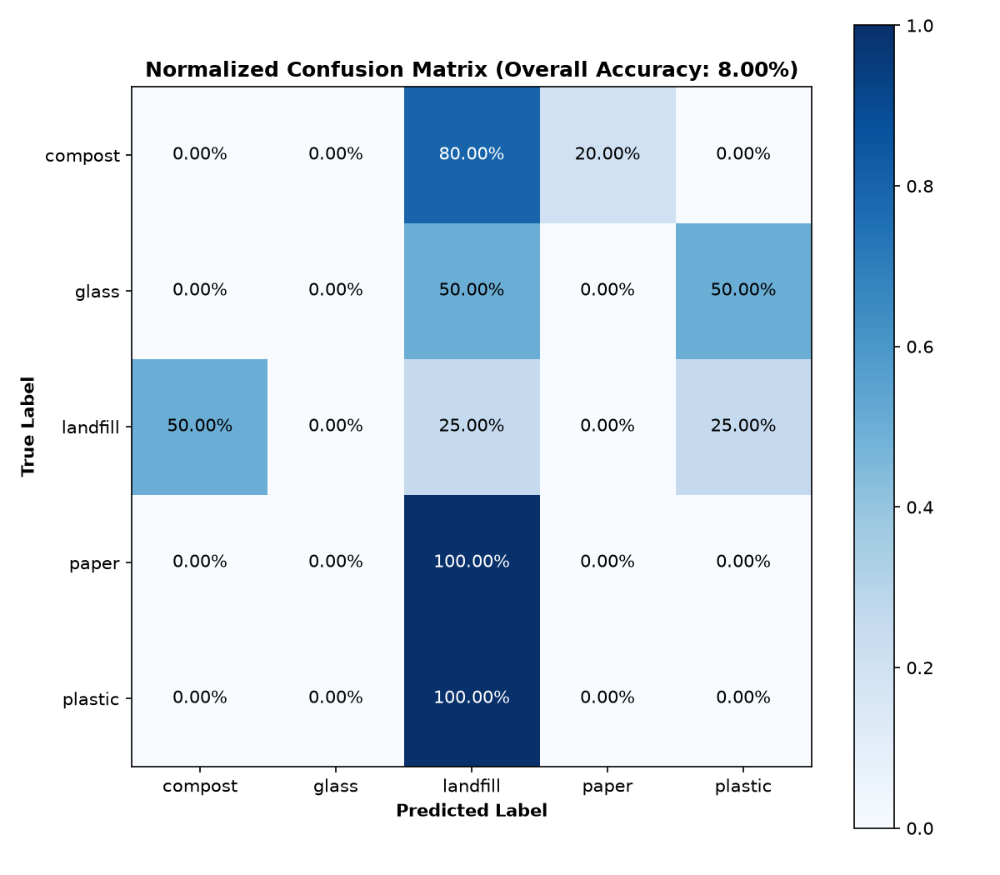

# Campus Evaluation Report

Frozen MVP model (MobileNetV2) evaluated on real waste photos taken around the UC Berkeley campus.

## Summary

| Metric | Value |
|---|---|
| Images evaluated | 25 |
| Campus accuracy | 8.0% |
| Lab test split accuracy | 85.0% |
| Gap (lab - campus) | 77.0% |

## Per-class accuracy

| Class | Images | Accuracy |
|---|---|---|
| landfill | 8 | 25% |
| compost | 5 | 0% |
| glass | 2 | 0% |
| paper | 5 | 0% |
| plastic | 5 | 0% |

Most reliably recognized: **landfill**. Least reliably recognized: **plastic**.

## Prediction distribution

| Predicted class | Count | Share |
|---|---|---|
| compost | 4 | 16% |
| glass | 0 | 0% |
| landfill | 17 | 68% |
| paper | 1 | 4% |
| plastic | 3 | 12% |

## Observations

- The model over-predicts **landfill** (68% of all predictions), which suggests it falls back to one class on unfamiliar real-world images.
- The model never predicted: glass.
- Campus accuracy is 77% lower than lab accuracy, indicating a domain gap between lab images and real photos.

## Most confident misclassifications

| Confidence | True | Predicted | File |
|---|---|---|---|
| 0.40 | plastic | landfill | `plastic05.jpg` |
| 0.34 | plastic | landfill | `plastic03.jpg` |
| 0.34 | compost | landfill | `compost04.jpg` |
| 0.34 | glass | plastic | `glass02.jpg` |
| 0.32 | paper | landfill | `paper04HEIC.jpg` |
| 0.31 | landfill | compost | `landfill03.jpg` |
| 0.31 | compost | landfill | `compost02.jpg` |
| 0.31 | plastic | landfill | `plastic02.jpg` |
| 0.31 | plastic | landfill | `plastic04.jpg` |
| 0.30 | landfill | compost | `landfill05.jpg` |

